# rdpshot

`rdpshot` is a single-binary RDP security-audit platform for authorized
penetration tests and internal audits. It discovers Remote Desktop services,
fingerprints the RDP negotiation, TLS and certificate posture of every
endpoint, runs a catalog of configuration and vulnerability checks (including a
safe BlueKeep detection probe), and — only with explicit authorization — audits
credentials and captures session screenshots. Results are stored in SQLite and
rendered as HTML, CSV or PDF reports, either from the CLI or from the bundled
web UI.

Beyond traditional scanning, rdpshot ships a full **Red Team & ASM toolkit**:
BloodHound CE export, MITRE ATT&CK heatmap, AI-powered executive summaries,
SARIF export for CI/CD pipelines, a DSL query language, MTTR trend analytics,
and a built-in RDP honeypot/decoy listener.

> ##  Legal / authorized-use warning
>
> `rdpshot` is dual-use security tooling. **Only scan systems you are
> explicitly authorized to test.** Unauthorized scanning and credential testing
> is illegal in most jurisdictions.
>
> * Vulnerability scanning is the default. Credential checks
>   (`--enable-auth`) and screenshot capture (`--enable-screens`) are
>   **disabled by default** and refuse to run without `--ack-authorized`,
>   which confirms you are permitted to test the targets.
> * The BlueKeep check is a **safe detection probe**. The tool never
>   generates or runs exploit code, payloads or shellcode.
> * Credential checks are bounded: a per-host failure limit
>   (`--max-auth-failures`, default 5; `0` disables the limit), a global connection rate limit
>   (`--rate`, default 10/s) and lockout detection stop the audit before
>   accounts are locked out.
> * Verified credentials are stored with restrictive file permissions and are
>   always masked in reports and in the UI.

## Features

### Core Scanning & Reconnaissance
* **Target handling** — IP, CIDR, hostname, `host:port` and `@file` target
  specifications, port lists and ranges, blacklist, hard expansion limits.
* **Reconnaissance** — TCP connect with RDP negotiation analysis (X.224 /
  RDP_NEG), NLA detection, TLS version and cipher capture, certificate
  analysis (chain, self-signed, expiry, SHA-256 fingerprint), server-side
  encryption level/method and MCS details.
* **Vulnerability checks** — BlueKeep (CVE-2019-0708) safe probe, NLA
  enforcement, weak encryption, obsolete TLS, self-signed and expired
  certificates, exposed RDP service. Findings are confirmation-first: only
  positively observed `vulnerable` or ruled-out `not_vulnerable` results are
  reported (no speculative Critical/potential noise).
* **Credential audit (opt-in)** — NLA/CredSSP + NTLMv2 dictionary checks with
  worker pool, jittered pacing, per-host failure budget and lockout
  detection. TLS/RDP-only hosts are skipped (aligned with `nla-not-required`);
  attempt timelines and stop reasons are persisted without secrets. OCR
  login-tile usernames are quality-gated and prepended into the same-scan
  wordlist for NLA hosts.
* **Session screenshots** — pre-auth login-screen capture over TLS; optional
  post-auth desktop capture via FreeRDP or pure-Go NLA bitmap framebuffer.
* **Compliance mapping** — findings mapped against **CIS Benchmarks**, **PCI-DSS 4.0**,
  **NIST SP 800-53**, and **ISO 27001**, rendered in executive HTML, CSV, and PDF reports.

### Red Team & Offensive Features
* **BloodHound CE JSON Export** — converts Blast Radius data (verified
  credentials, open hosts, BlueKeep exploitability) into a BloodHound
  Community Edition v5 `.json` file. Drag-and-drop into BloodHound to
  visualise CanRDP, HasSession, AdminTo and lateral movement paths.
  `GET /api/v1/estate/bloodhound.json`
* **Smart Password Spray Engine** — domain-aware Low & Slow spraying with
  per-account failure counters, configurable observation window and lockout
  duration, automatic cooldown queuing, and a global failure kill-switch.
  Modes: `low_slow` (one password per round across all accounts) and
  `aggressive`. `internal/spray` package.
* **Pass-the-Hash / Pass-the-Ticket** — NT hash and Kerberos ccache auth
  modes without requiring cleartext passwords.
* **Session Hijack Inspector** — detects unprompted RDP session shadowing
  (`rdp-shadow-unprompted-exposed`) and surfaces it on the MITRE heatmap as
  T1563.002.

### Blue Team, CISO & Compliance Features
* **MITRE ATT&CK Heatmap** — maps scan findings and verified credentials to
  8 RDP-relevant ATT&CK techniques (T1021.001, T1110.003, T1078, T1563.002,
  T1046, T1557, T1040, T1190). Each technique shows `detected`, `mitigated`,
  `potential`, or `not_applicable` status with evidence. Available at `/mitre`.
  `GET /api/v1/scans/{id}/mitre`
* **AI Executive Summary** — generates a professional 3–4 paragraph executive
  summary from scan data using Ollama (local), OpenAI, Anthropic Claude, or
  Google Gemini. Falls back to a deterministic template when no LLM is
  configured. EN and TR language support.
  `POST /api/v1/scans/{id}/ai-summary`
* **SARIF 2.1.0 Export** — exports findings in Static Analysis Results
  Interchange Format for GitHub Advanced Security, GitLab SAST, and any
  SARIF-aware CI/CD pipeline. The `?fail_on_critical=true` query parameter
  returns HTTP 422 when critical findings exist, acting as a hard CI/CD gate.
  `GET /api/v1/scans/{id}/sarif`
* **Compliance Radar** — CIS, PCI-DSS, NIST, ISO-27001 spider chart.
* **Policy-as-code** — declarative pass/fail gate and CI CLI (`rdpshot policy check`).
* **SIEM streaming** — JSON or CEF webhook on scan completion.

### Operator Experience & Search
* **DSL Query Language** — filter hosts and findings with a concise query
  syntax: `nla:false tls:1.0`, `severity:critical creds:true`,
  `cve:CVE-2019-0708 state:open`. Supported fields: `nla`, `tls`, `port`,
  `state`, `creds`, `severity`, `cve`, `os`, `grade`.
  `GET /api/v1/scans/{id}/hosts/search?q=...`
* **MTTR & Security Velocity** — mean and median days-to-remediate, open
  critical/high counts, remediation rate, new hosts in the last 7 days.
  Weekly new-vs-remediated trend charts. `GET /api/v1/mttr`
* **Kanban Triage Board** — drag-and-drop finding workflow (Open → Confirmed
  → False Positive → Remediated).
* **Remediation Playbooks** — one-click PowerShell, Registry, Ansible, and
  Bash fix scripts per finding. `GET /api/v1/playbooks/{check_id}/script`
* **Estate Map** — risk scatter and Blast Radius attack-path SVG graph.
* **Delta retest** — `base_scan_id` limits work to new/changed/open-triage hosts.
* **Engagement workspace** — scope freeze, host notes, evidence packs with
  SHA-256 manifest.

### Active Defense
* **Decoy / Honeypot Listener** — simulates a vulnerable Windows RDP server
  on a configurable port. Every connection: completes HYBRID negotiation,
  upgrades to TLS, parses the attacker's NTLM Negotiate blob to extract
  username/domain, fires a critical webhook alert, persists a `DecoyEvent`
  to SQLite, and writes to the audit log. No credentials are ever returned
  to the attacker.
  CLI: `rdpshot listen --bind 0.0.0.0:13389 --notify-webhook https://...`
  REST: `POST /api/v1/decoy/start`, `GET /api/v1/decoy/events`
  Web UI: `/decoy`

### Infrastructure & Platform
* **Zero heavy runtime** — no Node.js/NPM build chain; pure Go stdlib +
  Tailwind CDN + Chart.js + Vanilla JS.
* **Cryptographic & TLS posture** — proactive probe for TLS 1.0/1.1/1.2/1.3
  and legacy/weak cipher suites (RC4, 3DES/Sweet32, CBC).
* **Nmap & Masscan import** — import RDP targets directly from Nmap XML
  (`-oX`) or Masscan outputs via `--import-nmap` / `--import-file`.
* **MFA & PAM heuristics** — passive detection of Duo Security, CyberArk PSM,
  and Entra ID (Azure AD) pre-auth mechanisms.
* **Corporate SOAR & Webhooks** — instant alert webhook notifications for
  Slack, MS Teams, Discord, or generic JSON endpoints.
* **Active Directory / LDAP auto-discovery** — queries domain controllers for
  Windows servers and RDP SPNs.
* **Schedules** — five-field cron or interval cadence with optional webhooks.
* **Bulk scan cleanup** — tick rows (or select-all) in the Scans Dashboard and
  delete them in one request. Hidden rows drop out of the selection, active
  runs are cancelled first, and per-id failures are reported without aborting
  the rest (`POST /api/v1/scans/bulk-delete`).
* **Dark / Light theme** — Command Center (Dark) and Corporate Clean (Light).
* **Persistence** — SQLite (pure Go, no CGO), schema v6.

## UI screenshots

Sample captures from a local lab session (authorized RFC1918 targets only).
Full-size images live under [`docs/screenshots/`](docs/screenshots/).

### Command Center

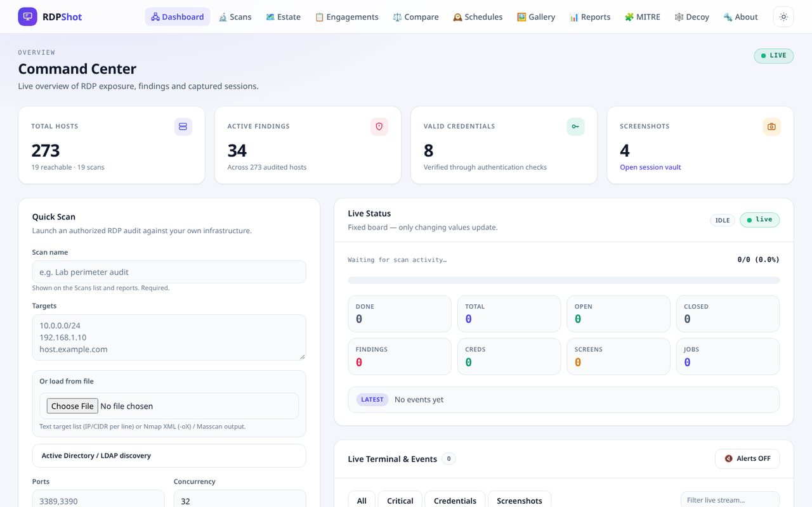

### Scans Dashboard

KPI cards, scan inventory filters, engagement/tag labels, and a compact
screenshot grid under the inventory table.

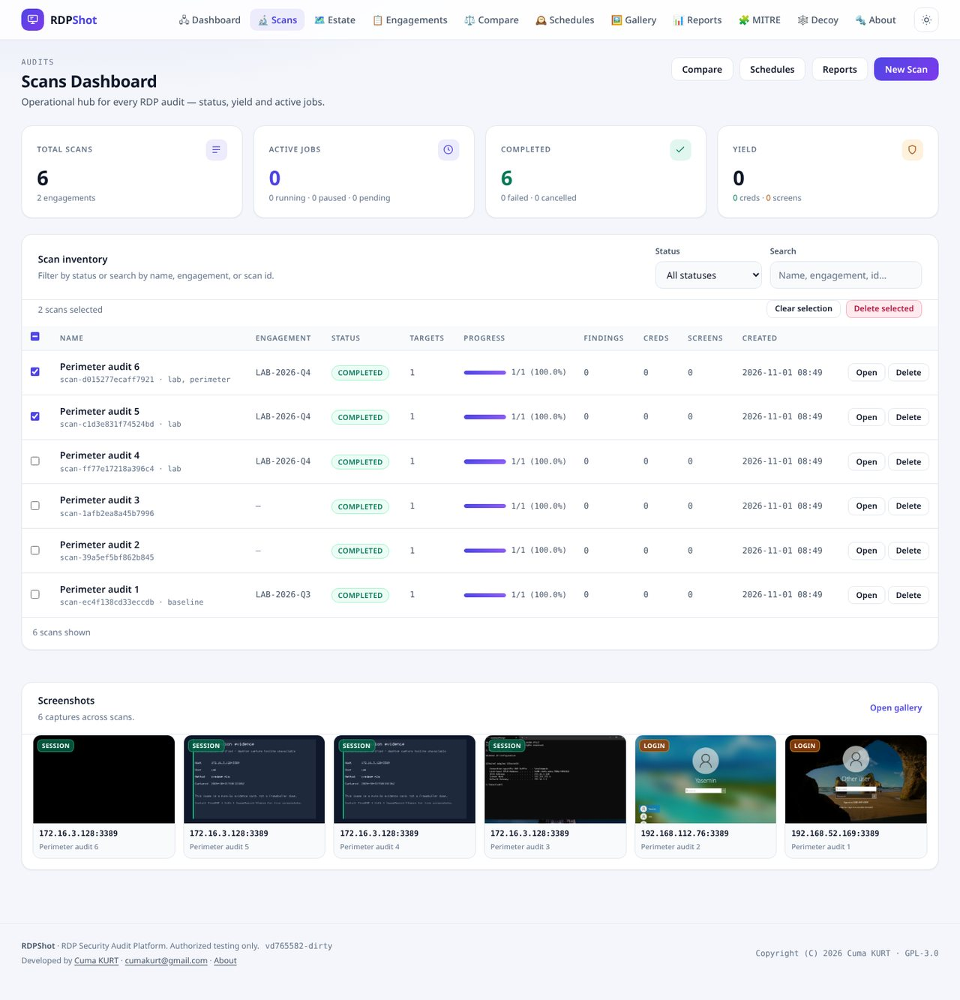

### Scan detail

Findings with the Table/Kanban toggle, compliance radar, verified credentials
and captured screenshots for one audit.

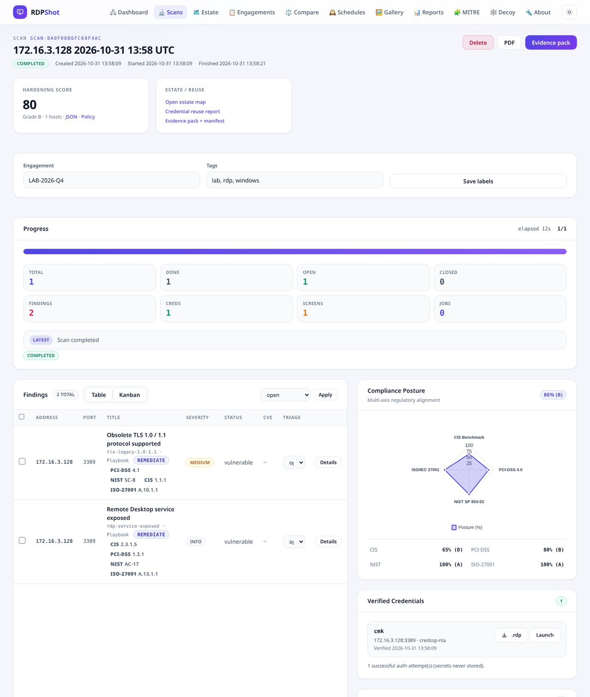

### Visual Session Vault

Real pre-auth login-screen evidence (synthetic detection cards omitted).

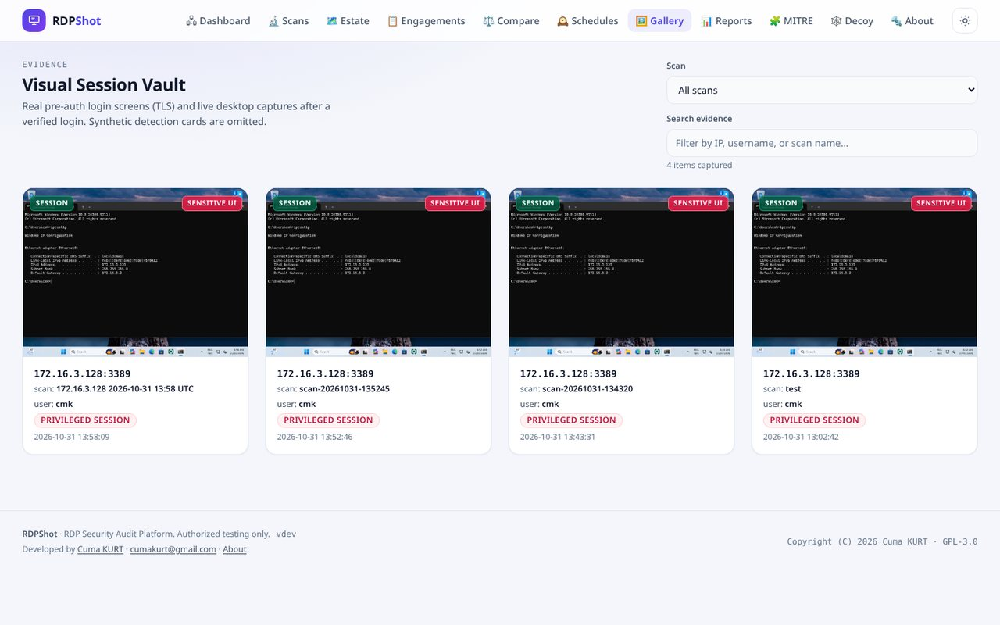

### Reports hub

Posture trend, compliance radar, SIEM streaming, report branding, alert rules
and the per-severity breakdown with one-click PDF/HTML/CSV export.

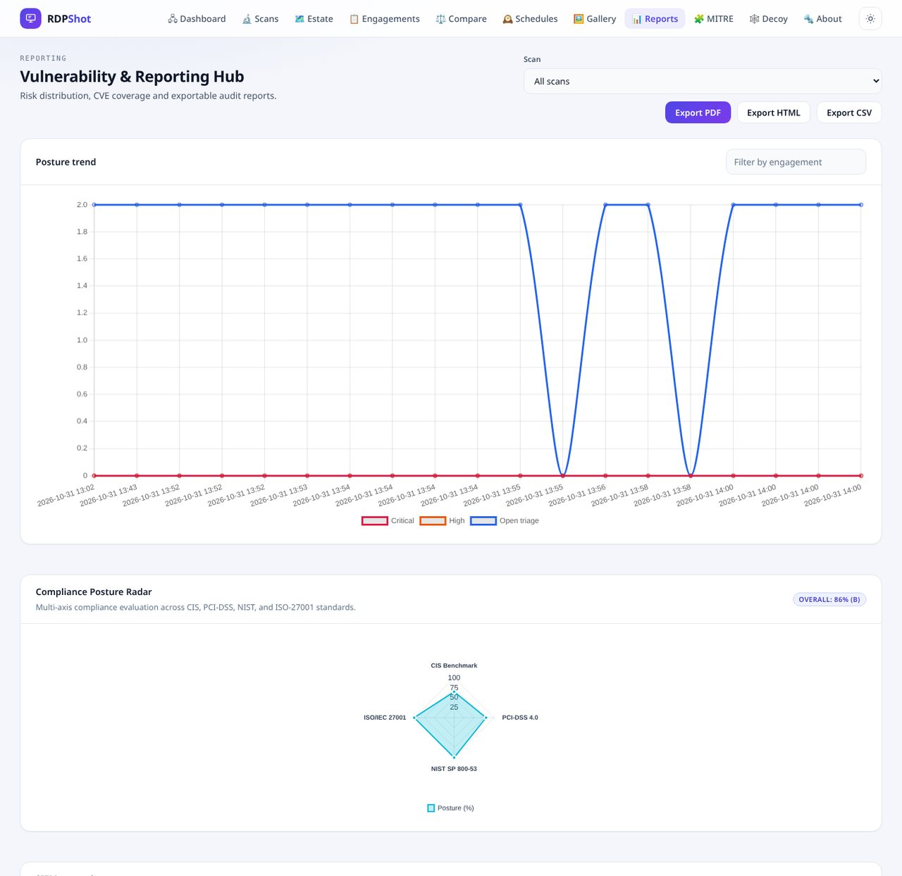

### Schedules

Exact first-run date/time picker plus interval or cron cadence.

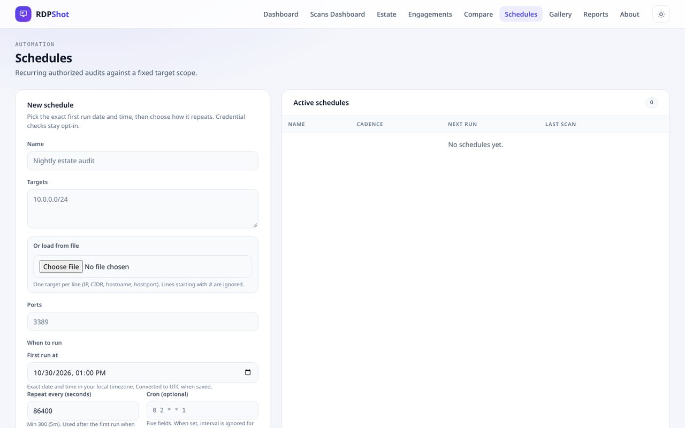

### Estate & engagements

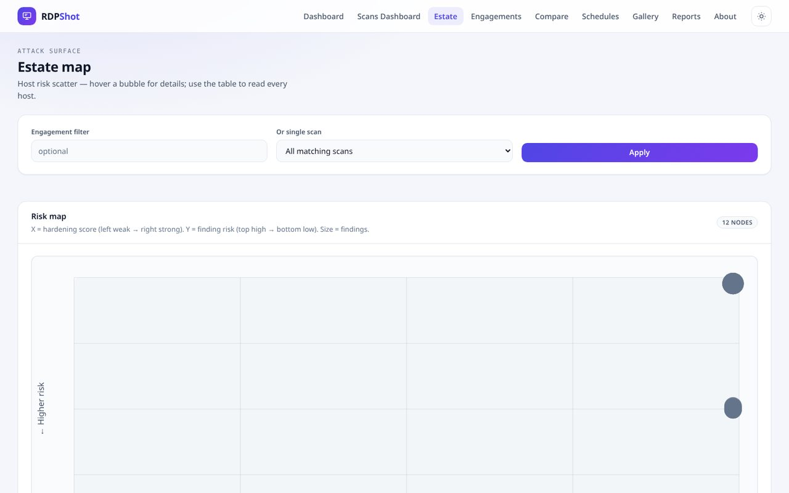

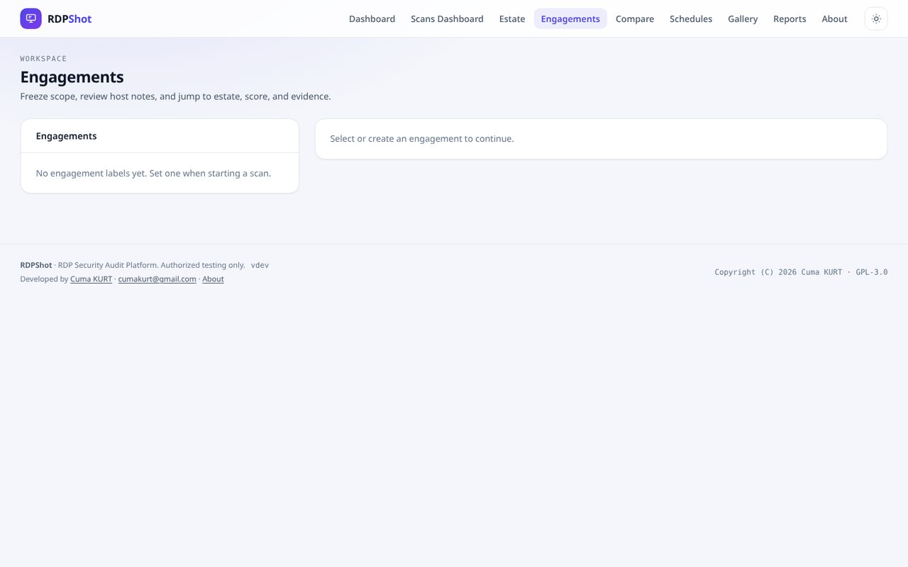

### Compare

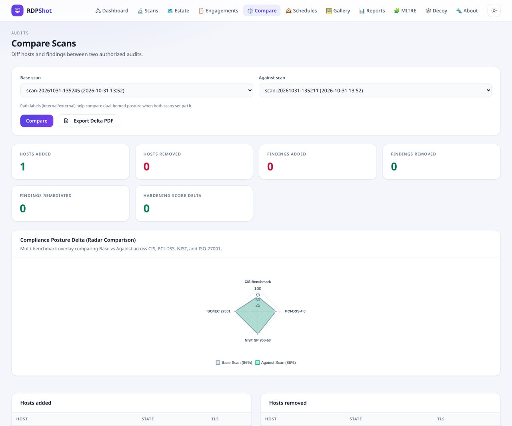

### MITRE ATT&CK coverage

Eight RDP-relevant techniques with `detected` / `potential` / `mitigated` /
`not_applicable` status and the evidence tags that produced it, loaded per
scan or engagement.

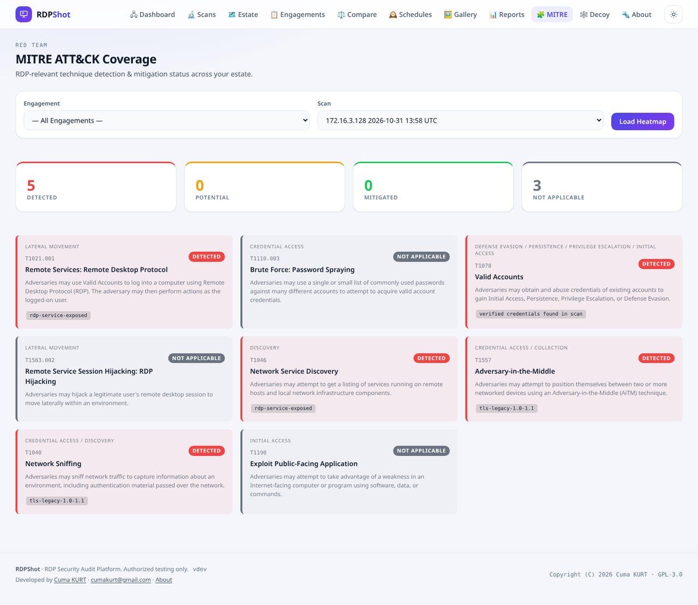

### Decoy / honeypot listener

Configurable fake RDP server with TLS profile, interactive mode and the live
capture table for connection stages, NTLM identity material and TLS metadata.

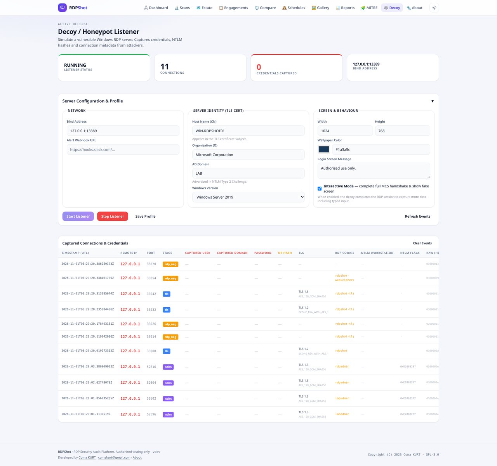

## Architecture

| Package | Responsibility |
|---|---|
| `cmd/rdpshot` | CLI entrypoint: `scan`, `serve`, `report`, `targets`, `listen`, `version` |
| `internal/about` | Product identity and developer credits shared by CLI, UI and reports |
| `internal/alerts` | Finding and scan completion alert evaluator |
| `internal/aisummary` | AI executive summary — Ollama, OpenAI, Anthropic, Gemini + template fallback |
| `internal/bloodhound` | BloodHound CE v5 JSON export builder (Computer/User nodes, CanRDP/HasSession edges) |
| `internal/brute` | Bounded, fail-safe credential-audit engine and wordlist handling |
| `internal/config` | Configuration resolution: defaults, JSON file, `RDSHOT_*` env, flags |
| `internal/credssp` | CredSSP/SPNEGO/TSRequest encoding for NLA authentication |
| `internal/cronexpr` | Five-field cron parser for schedule cadence |
| `internal/decoy` | Decoy/honeypot RDP listener — fake HYBRID negotiation, NTLM parse, DecoyEvent |
| `internal/discovery` | RD Web / Gateway / UDP detection probes |
| `internal/dsl` | DSL query language parser and host filter (`nla:false tls:1.0 severity:critical`) |
| `internal/engagement` | Evidence manifest hashing and scope freeze |
| `internal/estate` | Attack-surface graph builder and Blast Radius graph |
| `internal/events` | Bounded publish/subscribe hub for live events (SSE) |
| `internal/kerberos` | Kerberos CCache file parsing and pass-the-ticket injection |
| `internal/mitre` | MITRE ATT&CK heatmap — 8 RDP techniques mapped to scan findings |
| `internal/model` | Shared domain types (Scan, Host, Finding, Credential, Screenshot, Event, …) |
| `internal/notify` | Outbound SOAR webhook notifications (Slack, Teams, Discord, JSON) |
| `internal/ntlm` | NTLMv2 message construction and parsing |
| `internal/playbook` | Remediation script catalog (PowerShell, Registry, Ansible, Bash) |
| `internal/policy` | Declarative hardening policy evaluation |
| `internal/rdp` | RDP protocol stack: TPKT/COTP, X.224 + RDP_NEG, MCS/GCC, TLS info, safe probes |
| `internal/reporter` | HTML, CSV and PDF report rendering |
| `internal/sarif` | SARIF 2.1.0 export builder — GitHub Advanced Security / GitLab SAST compatible |
| `internal/scanner` | Scan engine: worker pool, rate limiter, stage orchestration |
| `internal/score` | Hardening / compliance scoring (A–F grade, CIS/PCI/NIST/ISO-27001 radar) |
| `internal/screenshot` | Auto grabber: FreeRDP → Go bitmap framebuffer → evidence card |
| `internal/siem` | JSON/CEF event formatting and delivery |
| `internal/spray` | Smart password spray engine — Low&Slow mode, per-account cooldown, lockout tracker |
| `internal/store` | SQLite persistence, aggregate queries, MTTR computation, decoy event store |
| `internal/target` | Target spec parsing and expansion (IP, CIDR, hostname, `@file`, blacklist) |
| `internal/vuln` | Vulnerability check catalog and finding evaluation |
| `web/` | Embedded templates + static assets (Tailwind CDN, Chart.js, Vanilla JS) |

## Install

### Automated installer (Linux)

`install.sh` detects the distribution (apt/dnf/yum/pacman/apk/zypper), installs
any missing build tooling including a Go toolchain, builds the project and
installs it under `/usr/local/rdpshot` with a symlink at `/usr/local/bin/rdpshot`.
Already installed packages are never downloaded again and the project is only
rebuilt when the sources changed.

```sh
sudo ./install.sh                 # install (progress bar, quiet output)
sudo ./install.sh --force         # rebuild even when nothing changed
sudo ./install.sh --dry-run       # show what would happen
sudo ./install.sh --uninstall     # remove the installation
```

### From source

Requires Go 1.27+.

```sh
git clone https://github.com/cumakurt/rdpshot.git && cd rdpshot
make build            # builds bin/rdpshot
# or
go build -trimpath -ldflags "-X main.version=$(git describe --always)" -o bin/rdpshot ./cmd/rdpshot
```

Cross-compiled binaries for linux/windows/darwin (amd64 + arm64):

```sh
make cross
```

### Docker

The fastest path is the Docker installer, which follows the same
single-line progress bar as `install.sh` but needs no Go toolchain on the
host — the project is compiled inside a multi-stage image build:

```sh
./install_docker.sh                        # build image + start the container
./install_docker.sh --localhost            # publish on 127.0.0.1 only
./install_docker.sh --token "$(openssl rand -hex 24)"
./install_docker.sh --target full          # add FreeRDP/Xvfb/ImageMagick
./install_docker.sh --force                # rebuild an unchanged tree
./install_docker.sh --dry-run              # show what would happen
./install_docker.sh --uninstall            # container, image, volume, .env
```

It installs Docker Engine and the Compose plugin when they are missing,
writes the runtime settings to `.env` (mode 0600), rebuilds only when the
sources changed, polls `/api/v1/about` until the UI actually answers, and
finishes with the copy-pasteable `docker compose` / `docker run` commands for
starting, inspecting and stopping the container.
Settings in `.env` drive `docker-compose.yml`, so plain Compose keeps working:

```sh
docker build -t rdpshot .                       # slim runtime (default)
docker build --target full -t rdpshot:full .    # adds the capture toolchain
docker run --rm -p 8722:8722 -v rdpshot-data:/data rdpshot
# or
docker compose up -d
```

The slim image is distroless and runs as a non-root user; the `full` image
adds the screenshot capture toolchain (`xfreerdp`, `xvfb-run`, ImageMagick).
Both images write results to `/data` and ship the default wordlists under
`/usr/share/rdpshot/wordlists/`, with `RDSHOT_USER_WORDLIST` and
`RDSHOT_PASSWORD_WORDLIST` pointing at them.

## Quick start

Scan a subnet in the foreground:

```sh
rdpshot scan 10.0.0.0/24
```

Serve the web UI on <http://127.0.0.1:8722/>:

```sh
rdpshot serve
```

Run an authorized credential audit and capture screenshots (both require the
explicit acknowledgement):

```sh
rdpshot scan --enable-auth --enable-screens --ack-authorized \
  --user-wordlist wordlists/default_users.txt \
  --password-wordlist wordlists/default_passwords.txt \
  10.0.0.0/24
```

Single credential or pass-the-hash (also require `--ack-authorized`; these modes
imply `--enable-auth` and auto-enable screenshots):

```sh
rdpshot scan --ack-authorized --auth-mode=single \
  --auth-user alice --auth-domain CORP --auth-password '...' \
  10.0.0.10

rdpshot scan --ack-authorized --auth-mode=pth \
  --auth-user bob --auth-nthash a4f49c406510bdcab6824ee7c30fd852 \
  10.0.0.10

rdpshot scan --ack-authorized --auth-ccache /tmp/krb5cc_1000 \
  10.0.0.10
```

Import targets from an existing Nmap XML discovery run:

```sh
rdpshot scan --import-nmap /path/to/scan.xml --enable-vuln
```

On a successful single/PTH login the tool captures a screenshot and
**disconnects immediately** (no lingering interactive session).

`--auth-domain` sets the default domain for wordlist, single, and PTH modes.
Wordlist lines may still embed `DOMAIN\user` or `user@domain` (those win).
`--auth-nthash` accepts a 32-character hex NT hash or an `LM:NT` pair.

Generate a PDF report or an Executive Delta Comparison PDF:

```sh
# Management report for one scan
rdpshot report --scan <scan-id> --format pdf

# Executive one-pager comparing two scans (burn-down & remediation)
rdpshot report --scan <new-scan-id> --compare <old-scan-id> --format pdf
```

## CLI reference

```
rdpshot <command> [flags] [targets...]
```

Flags must come before the target specifications. Targets are one or more of:
`192.168.1.10`, `10.0.0.0/24`, `host.example.com`, `10.0.0.5:3389`,
`@targets.txt` (one specification per line).

| Command | Purpose | Key flags |
|---|---|---|
| `scan` | Run a scan in the foreground | `--name`, `--ports` (default `3389`), `--blacklist`, `--concurrency`, `--rate`, `--timeout`, `--max-targets`, `--max-auth-failures`, `--enable-vuln` (default on), `--enable-auth`, `--enable-screens`, `--enable-udp`, `--ack-authorized`, `--user-wordlist`, `--password-wordlist`, `--auth-mode wordlist\|single\|pth`, `--auth-user`, `--auth-domain` (all modes), `--auth-password`, `--auth-nthash`, `--auth-ccache`, `--ad-server`, `--ad-domain`, `--ad-user`, `--ad-pass`, `--import-file/--import-nmap`, `--webhook-url`, `--webhook-level`, `--report none\|html\|csv\|pdf`, `--report-dir`, `--db`, `--outputs`, `--config`, `--log-level`, `--log-format` |
| `serve` | Start the web UI and REST API | `--addr` (default `127.0.0.1:8722`), `--token`, `--db`, `--outputs`, `--config`, `--log-level`, `--log-format`, `--user-wordlist`, `--password-wordlist`, `--max-auth-failures`, `--max-targets`, `--max-concurrent-scans` (default `2`), `--webhook-url`, `--webhook-level` |
| `report` | Render a stored scan into a report | `--scan <id>` (required), `--format html\|csv\|pdf`, `--compare <against-id>` (Executive Delta diff PDF), `-o/--output`, `--db` |
| `policy check` | CI gate against a stored scan | `--scan <id>` (required), `--db`, `--policy path.json` (optional) |
| `targets` | Resolve targets and print `address:port` lines | `--ports`, `--blacklist`, `--max-targets`, `--import-file/--import-nmap`, `--ad-server`, `--ad-domain`, `--ad-user`, `--ad-pass` |
| `listen` | Start a decoy RDP honeypot listener | `--bind` (default `0.0.0.0:13389`), `--decoy-port`, `--notify-webhook <url>`, `--db`, `--log-level` |
| `version` | Print `rdpshot <version>` | — |

Progress and diagnostics go to stderr; results go to stdout. Exit codes:
`0` success, `1` runtime error (including a cancelled scan or policy fail), `2` usage or
validation error. In particular, `--enable-auth`/`--enable-screens` without
`--ack-authorized` exits with code 2 and does not touch the network.

### Policy CI gate

```sh
rdpshot policy check --db outputs/rdpshot.db --scan <scan-id>
# exit 0 = pass, exit 1 = fail, exit 2 = error
```

Example GitHub Actions step:

```yaml
- name: Policy gate
  run: rdpshot policy check --db outputs/rdpshot.db --scan "$SCAN_ID"
```

## Configuration

Values are resolved with the following precedence (highest first):

1. command line flags
2. environment variables (`RDSHOT_*`)
3. JSON config file (`--config`)
4. built-in defaults

| Setting | Env | Flag | Default |
|---|---|---|---|
| database path | `RDSHOT_DB` | `--db` | `outputs/rdpshot.db` |
| outputs directory | `RDSHOT_OUTPUTS` | `--outputs` | `outputs` |
| concurrency | `RDSHOT_CONCURRENCY` | `--concurrency` | `64` |
| rate (conn/s) | `RDSHOT_RATE` | `--rate` | `10` |
| dial timeout | `RDSHOT_TIMEOUT` | `--timeout` | `5s` |
| max targets | `RDSHOT_MAX_TARGETS` | `--max-targets` | `0` (unlimited; set a positive value to cap) |
| max auth failures per host | `RDSHOT_MAX_AUTH_FAILURES` | `--max-auth-failures` | `5` (`0` = unlimited / no lockout fail-safe) |
| server addr | `RDSHOT_ADDR` | `--addr` | `127.0.0.1:8722` |
| auth token | `RDSHOT_TOKEN` | `--token` | empty (localhost only) |
| log level | `RDSHOT_LOG_LEVEL` | `--log-level` | `info` |
| log format | `RDSHOT_LOG_FORMAT` | `--log-format` | `text` |
| user wordlist | `RDSHOT_USER_WORDLIST` | `--user-wordlist` | `wordlists/default_users.txt` |
| password wordlist | `RDSHOT_PASSWORD_WORDLIST` | `--password-wordlist` | `wordlists/default_passwords.txt` |

The JSON config file uses the same names as the settings above in snake_case
(`db_path`, `outputs_dir`, `concurrency`, `rate`, `timeout`, `max_targets`,
`max_auth_failures`, `addr`, `token`, `log_level`, `log_format`,
`user_wordlist`, `password_wordlist`). `timeout` is a Go duration encoded in
nanoseconds (e.g. `5000000000` for 5s); prefer `RDSHOT_TIMEOUT=5s` when in
doubt.

Scans started from the CLI or the web form carry their own per-scan options
(targets, ports, blacklist, enable flags, wordlists) which override the
resolved defaults.

## Web UI and REST API

`rdpshot serve` listens on `127.0.0.1:8722` by default. When the listener is
reachable beyond localhost, set `--token` (or `RDSHOT_TOKEN`): every route then
requires `Authorization: Bearer <token>` or `?token=`.

Web pages: `/` command-center dashboard, `/scans` scans dashboard, `/scans/{id}` live scan detail,
`/compare` scan diff, `/engagements` workspace, `/schedules` recurring audits,
`/gallery` screenshot gallery, `/reports` report center, `/mitre` ATT&CK heatmap,
`/decoy` honeypot listener, `/about` developer credits.

| Method | Route | Description |
|---|---|---|
| `POST` | `/api/v1/scans` | Start a new scan (multipart wordlist uploads supported) |
| `GET` | `/api/v1/scans` | List past scans |
| `GET` | `/api/v1/scans/{id}` | Scan detail and progress |
| `PATCH` | `/api/v1/scans/{id}` | Rename a scan |
| `DELETE` | `/api/v1/scans/{id}` | Delete a finished scan and its artifacts |
| `POST` | `/api/v1/scans/bulk-delete` | Delete several scans in one request (`{"ids":[...]}`) |
| `POST` | `/api/v1/scans/{id}/cancel` | Cancel a running or paused scan |
| `POST` | `/api/v1/scans/{id}/pause` | Pause a running scan (queued work is kept) |
| `POST` | `/api/v1/scans/{id}/resume` | Resume a paused scan |
| `POST` | `/api/v1/scans/{id}/brute` | Credential-only re-audit of discovered hosts |
| `GET` | `/api/v1/scans/{id}/diff?against={id}` | Diff hosts/findings against another scan |
| `GET` | `/api/v1/scans/{id}/findings` | Findings of a scan |
| `GET` | `/api/v1/scans/{id}/hosts` | Hosts of a scan |
| `GET` | `/api/v1/scans/{id}/screenshots` | Screenshot metadata of a scan |
| `GET` | `/api/v1/scans/{id}/credentials` | Verified credentials (masked) |
| `GET` | `/api/v1/scans/{id}/report?format=html\|csv\|pdf` | Download a report for one scan |
| `GET` | `/api/v1/reports/export?format=html\|csv\|pdf&scan={id}\|all` | Download a report for one scan or all scans (embeds screenshots) |
| `GET` | `/api/v1/reports/compare-pdf?base={id}&against={id}` | Download comparative executive summary diff PDF |
| `GET` | `/api/v1/schedules` | List recurring schedules |
| `POST` | `/api/v1/schedules` | Create a schedule (`run_at` datetime, interval/cron) |
| `GET` | `/api/v1/schedules/{id}` | Schedule detail |
| `PATCH` | `/api/v1/schedules/{id}` | Enable/disable, retune, set `run_at`, or run-now |
| `DELETE` | `/api/v1/schedules/{id}` | Delete a schedule |
| `GET` | `/api/v1/settings/wordlists` | Current default wordlist paths |
| `PATCH` | `/api/v1/settings/wordlists` | Update runtime default wordlist paths |
| `GET` | `/api/v1/summary` | Dashboard summary |
| `GET` | `/api/v1/about` | Product version and developer credits |
| `GET` | `/api/v1/analytics` | Cross-scan posture analytics |
| `GET` | `/api/v1/trend` | Posture trend/baseline series |
| `PATCH` | `/api/v1/findings/{fid}/triage` | Update finding triage status/note |
| `POST` | `/api/v1/findings/bulk-triage` | Bulk update finding triage |
| `PATCH` | `/api/v1/scans/{id}/meta` | Update engagement/tags |
| `GET` | `/api/v1/scans/{id}/evidence-pack` | Download evidence ZIP (includes `manifest.json`) |
| `GET` | `/api/v1/scans/{id}/score` | Hardening / compliance score |
| `GET` | `/api/v1/scans/{id}/policy` | Evaluate scan against stored policy |
| `GET` | `/api/v1/scans/{id}/reuse` | Credential reuse across hosts |
| `GET` | `/api/v1/estate` | Estate risk graph (`engagement`, `scan_id`) |
| `GET/PUT` | `/api/v1/policy` | Hardening policy document |
| `GET` | `/api/v1/playbooks` | Remediation playbook catalog |
| `GET` | `/api/v1/playbooks/{check_id}` | One remediation playbook |
| `GET/PUT` | `/api/v1/host-notes` | Host notes (PUT upsert) |
| `DELETE` | `/api/v1/host-notes/{id}` | Delete a host note |
| `GET/PUT` | `/api/v1/settings/siem` | SIEM webhook sink (JSON/CEF) |
| `GET/PUT` | `/api/v1/settings/alerts` | Post-scan alert rules |
| `GET` | `/api/v1/engagements` | List engagement labels |
| `POST` | `/api/v1/engagements/freeze` | Freeze engagement scope snapshot |
| `GET` | `/api/v1/engagements/scope` | Load frozen engagement scope |
| `GET/PUT` | `/api/v1/settings/branding` | Report branding metadata (incl. logo data URI) |
| `GET/POST` | `/api/v1/wordlist-sets` | Named wordlist sets |
| `DELETE` | `/api/v1/wordlist-sets/{id}` | Delete a wordlist set |
| `POST` | `/api/v1/login` | Local user login (session token) |
| `GET/POST` | `/api/v1/users` | List/create local users |
| `DELETE` | `/api/v1/users/{id}` | Delete a local user |
| `GET` | `/api/v1/audit` | Recent audit log entries |
| `GET` | `/api/v1/events` | Live event stream (SSE, `?scan=` filters) |
| `GET` | `/api/v1/estate/bloodhound.json` | **[NEW]** BloodHound CE v5 JSON export (`?engagement=` / `?scan_id=`) |
| `GET/PUT` | `/api/v1/settings/ai` | **[NEW]** LLM config (Ollama/OpenAI/Anthropic/Gemini; API key redacted on GET) |
| `GET` | `/api/v1/scans/{id}/mitre` | **[NEW]** MITRE ATT&CK heatmap for one scan |
| `GET` | `/api/v1/mitre` | **[NEW]** MITRE heatmap across an engagement (`?engagement=`) |
| `POST` | `/api/v1/scans/{id}/ai-summary` | **[NEW]** Generate AI executive summary (cached) |
| `GET` | `/api/v1/scans/{id}/ai-summary` | **[NEW]** Retrieve cached executive summary |
| `GET` | `/api/v1/scans/{id}/sarif` | **[NEW]** SARIF 2.1.0 export (`?fail_on_critical=true` for CI gate) |
| `GET` | `/api/v1/scans/{id}/hosts/search` | **[NEW]** DSL host filter (`?q=nla:false+tls:1.0`) |
| `GET` | `/api/v1/scans/{id}/spray/status` | **[NEW]** Smart spray per-account lockout counters |
| `GET` | `/api/v1/mttr` | **[NEW]** Mean-Time-to-Remediate stats (`?engagement=&period=30d`) |
| `GET` | `/api/v1/trend/weekly` | **[NEW]** Weekly new-vs-remediated finding trend buckets |
| `POST` | `/api/v1/decoy/start` | **[NEW]** Start the honeypot/decoy listener |
| `POST` | `/api/v1/decoy/stop` | **[NEW]** Stop the honeypot/decoy listener |
| `GET` | `/api/v1/decoy/status` | **[NEW]** Decoy listener running status and event count |
| `GET` | `/api/v1/decoy/events` | **[NEW]** Captured attacker connections (newest first) |

## Vulnerability checks

| Check ID | CVE | Severity | Method |
|---|---|---|---|
| `rdp-service-exposed` | — | info | RDP listener reachable |
| `nla-not-required` | — | high | Negotiation selected RDP or TLS-only without CredSSP/NLA |
| `rdp-security-without-tls` | — | medium | Legacy RDP security layer negotiated without TLS |
| `bluekeep-cve-2019-0708` | CVE-2019-0708 | critical | Confirmed MCS Disconnect Provider Ultimatum after safe `MS_T120` probe |
| `weak-encryption` | — | high | Encryption level `none/low` or exclusively 40/56-bit RC4 methods |
| `weak-tls` | — | medium | TLS 1.0/1.1/SSL3 or weak cipher (RC4/3DES/NULL) |
| `tls-legacy-1.0-1.1` | — | medium | Probed server accepts obsolete TLS 1.0 / 1.1 protocols |
| `tls-weak-cipher` | — | medium | Probed server offers weak or legacy cipher suites (RC4/3DES/CBC) |
| `self-signed-cert` | — | medium | Self-signed certificate chain |
| `expired-cert` | — | medium | Certificate `NotAfter` in the past |
| `rdp-negotiation-failure` | — | low | Server returned `RDP_NEG_FAILURE` |
| `cert-hostname-mismatch` | — | medium | DNS SANs present and do not match scanned hostname |
| `rd-web-exposed` / `rd-gateway-exposed` | — | info | Confirmed discovery markers |
| `udp-3389-open` | — | low | UDP/3389 returned a response payload |
| `nla-smartcard-required` | — | info | Smartcard required for NLA |
| `nla-kerberos-offered` | — | info | CredSSP advertises Kerberos support |
| `mfa-enforced` | — | info | Multi-Factor Authentication (Duo / Azure AD) detected |
| `pam-proxy-detected` | — | info | Privileged Access Management (CyberArk PSM) proxy detected |
| `rdp-honeypot-detected` | — | high | Handshake timing and anomalies match honeypot signatures |
| `rdp-nla-downgrade-vulnerable` | — | high | Server permits non-NLA session fallback when NLA omitted |
| `rdp-shadow-unprompted-exposed` | — | high | Shadowing capability permits session takeover without user consent |

## Limitations

* **BlueKeep detection is a safe probe only.** Two benign `MS_T120` channel
  messages are sent and the server's reaction is observed; no exploit code,
  payload or shellcode is generated or executed. `vulnerable` is reported only
  when an MCS Disconnect Provider Ultimatum follows a complete check pair.
* **NLA-enforced (HYBRID / HYBRID_EX) sessions are not probed for BlueKeep.**
  The virtual-channel layer needed by the probe is unavailable there, so no
  BlueKeep finding is emitted (avoids Critical false positives).
* **DejaBlue is not reported remotely.** CVE-2019-1181/1182 cannot be confirmed
  without local patch evidence; the scanner does not invent Critical findings.
* **Screenshots require external tooling**: FreeRDP (`xfreerdp`), Xvfb
  (`xvfb-run`) and ImageMagick (`import`) or `ffmpeg` on the host, or the
  `full` Docker target. The slim image reports the missing tooling and skips
  captures. Capture is implemented for Linux-style hosts with those tools;
  there is no native Windows or macOS capture path.
* **No exploitation, dumping or lateral movement.** Credential hashes, ticket
  extraction and post-exploitation are out of scope by design.
* The web UI has a single shared bearer token, not per-user accounts; keep it
  on localhost or behind a reverse proxy with proper authentication.

## Development

| Command | Description |
|---|---|
| `make build` | Build `bin/rdpshot` (version stampable via `VERSION=`) |
| `make test` | `go test ./...` |
| `make vet` | `go vet ./...` |
| `make fmt` | `gofmt -w .` |
| `make lint` | Fail when `gofmt -l .` is non-empty, then `go vet ./...` |
| `make cross` | Cross-compile linux/windows/darwin (amd64 + arm64) into `bin/` |
| `make docker` | Build the `slim` and `full` images |
| `make clean` | Remove `bin/` |

Tests live next to the code as `*_test.go` in each `internal/*` package and
cover target parsing, config precedence, byte-level protocol encode/decode,
the rate limiter, the store and report rendering.

Default wordlists for authorized audits live in `wordlists/`. They contain
well-known weak accounts and passwords and exist to prove that defaults are
still in use on the target — change them on real systems.

## Author

| | |
|---|---|
| Developer | Cuma KURT |
| Email | [cumakurt@gmail.com](mailto:cumakurt@gmail.com) |
| GitHub | [github.com/cumakurt/rdpshot](https://github.com/cumakurt/rdpshot) |
| LinkedIn | [linkedin.com/in/cuma-kurt-34414917](https://www.linkedin.com/in/cuma-kurt-34414917/) |

## License

rdpshot is released under the [GNU General Public License v3.0](LICENSE)
(GPL-3.0). See the `LICENSE` file for the full terms.

Copyright (C) 2026 Cuma KURT <cumakurt@gmail.com>

This program is free software: you can redistribute it and/or modify it under
the terms of the GNU General Public License as published by the Free Software
Foundation, either version 3 of the License, or (at your option) any later
version. This program is distributed in the hope that it will be useful, but
WITHOUT ANY WARRANTY; without even the implied warranty of MERCHANTABILITY or
FITNESS FOR A PARTICULAR PURPOSE.